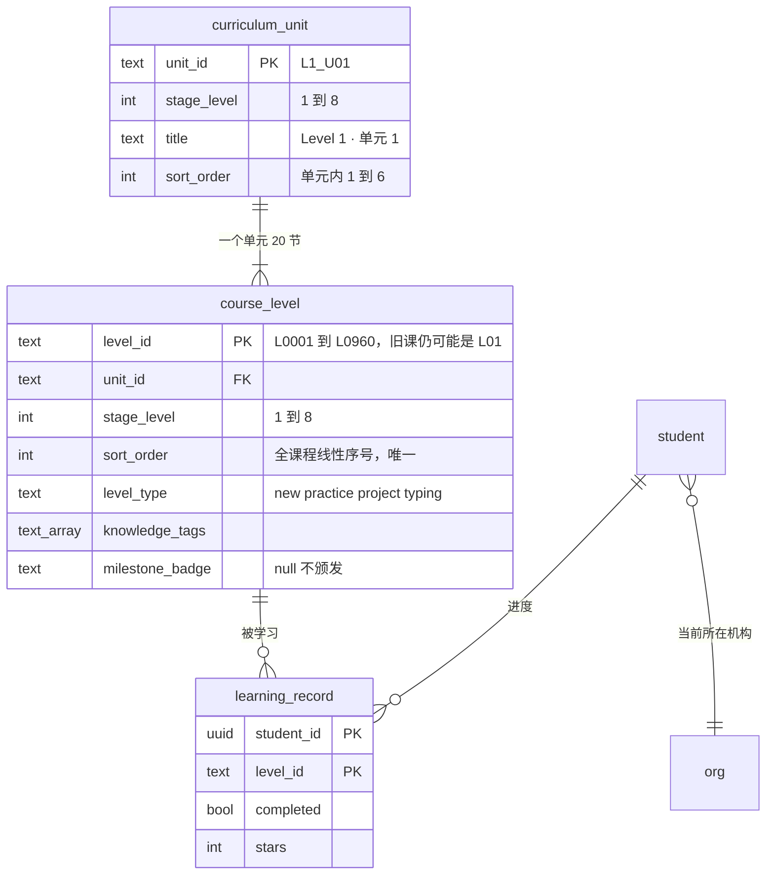

# 课程体系数据模型

课程顶层是 **Level 1–8**。每个 Level 6 个单元、120 节，一共 **960** 节。进度只挂在学生身上。界面不使用年级或学期。

产品上的层级是：`stage_level` → 单元 → 课时。库里早期的学期表还留着，用来满足旧的外键，标题已改成 Level 1–8，页面和导入接口不再读取学期。

## 关系



`learning_record` 和 `org` 之间没有连线。进度表的主键是 `(student_id, level_id)`，**不能加 `org_id`**。学生换机构时只更新 `student.org_id`，不新建学生、不复制进度，也不清进度。

`student.current_level_order` 只是没有学习记录时的回落值，家长端的「当前学段」也读它。有 `learning_record` 之后，地图上的完成数以记录为准。

## 960 节怎么摊开

| 方向 | 做法 |
| --- | --- |
| 纵向 | `stage_level`（1–8）→ 单元 → `course_level` |
| 横向 | 每个 Level 固定 6 个单元。单元编号 `L1_U01` 到 `L8_U06` |
| 容量 | 每个 Level 120 节。8 × 120 = 960 |
| 线性序号 | `course_level.sort_order` 全表唯一。第 1–120 节是 Level 1，第 121–240 节是 Level 2，依此类推。试用「前 3 关」仍看这个序号 |
| 标题 | 单元写「Level 1 · 单元 1」。占位课写「Level 1 · 单元 2 · 第 1 关」。已写好的课文保留原标题 |

Level 1 第 1 单元是已经写好的 20 节，其中第 19 节是打字关，第 20 节是项目关。第 16–18 节和第 21 节之后是占位。其余单元严格 12 节新课、5 节练习、2 节打字、1 节项目。

## 两套 level_type

`course_level.level_type` 是课型，只能是 `new`、`practice`、`project`、`typing`。

课时正文 `body.level_type` 仍是回合形态：`normal`（全抄）、`fill_blank`（挖空）、`debug`（找茬）。学生端回合读正文，不读课型列。课程包里回合形态写在 `exercise`，导入时放进正文的 `level_type`。

`knowledge_tags` 是字符串数组，例如 `["for_loop", "range"]`。

`milestone_badge` 是徽章标识。`null` 表示完成本课不颁发；非空字符串表示颁发哪一枚。

正文不再保存 `grade_range`。

## 进度怎么取

```text
student_curriculum_position(student_id)
```

这个函数只收学生 id。有学习记录时，按 `sort_order` 找第一节还没完成的课，再连上单元和 `stage_level`。一节都没完成则停在第一节；全部完成则停在最后一节。完全没有记录时，才用 `student.current_level_order`。

地图不一次返回 960 个节点。首页只给当前 Level（以及已经学到的更早 Level）的单元摘要；展开某个单元时再取那 20 节。

旧表 `level_progress` 保留，不再写入。新读写都走 `learning_record`。

## 课程包

导入一个单元时写 `stage_level` 和单元，不再写学期。`stage_level` 取 1 到 8。单元编号用 `L1_U01` 这种形式。

```json
{
  "stage_level": 1,
  "unit": { "unit_id": "L1_U02", "title": "Level 1 · 单元 2", "sort_order": 2 },
  "levels": [
    {
      "level_id": "L0021",
      "order": 21,
      "title": "Level 1 · 单元 2 · 第 1 关",
      "goal": "这一节先熟悉 variable、if，课文还在编写。",
      "knowledge_tags": ["variable", "if"],
      "level_type": "new",
      "milestone_badge": null,
      "exercise": "normal",
      "preview_kind": "text",
      "demo_code": "n = 1\nprint(n)",
      "expected_output": "1",
      "teach_code_lines": ["n = 1", "print(n)"],
      "keywords": ["print", "print()", "n = 1"],
      "estimated_minutes": 15
    }
  ]
}
```

同一 Level 的下一单元换 `unit_id` 和 `sort_order`。一个 Level 的课时加到 120 为止。
